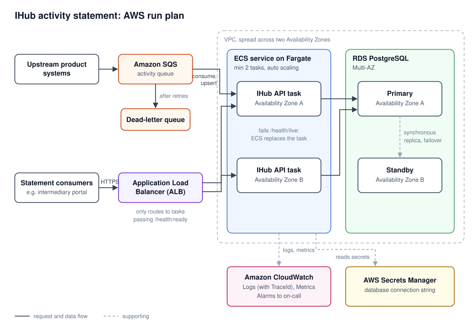

# IHub intermediary activity statement

## The problem

IHub turns activities from product systems (commissions, fees, adjustments) into a statement of what
each intermediary earned over a period. Summing amounts is easy. 

The ticky portion is the input: activities can arrive more than once, corrections can arrive before the original, and submissions for the same
intermediary can land at the same time during peaks.

All three cases reduce to one requirement: each upstream activity is stored once, and only its latest
version counts. I enforce that in the database rather than in application code, so it holds regardless
of how many API instances run or what order requests arrive in, without locks or a queue.
---

## Task 1: Ingestion and statement

### API

One ingestion endpoint and one retrieval endpoint, both HTTP.

#### `POST /activities`
```json
{
  "source": "life-admin",
  "externalId": "C-1001",
  "version": 1,
  "intermediaryId": "BRK-001",
  "activityType": "commission",
  "occurredAt": "2026-11-01T09:30:00+02:00",
  "amount": 1250.00,
  "currency": "ZAR"
}
```

- `source` + `externalId` identify the activity uniquely.
- `version` increases when upstream revises the activity; I use it to decide which submission wins.
- `occurredAt` is when the activity happened, not when it arrived, and must include a UTC offset.
- `amount` allows 2 decimal places and can be negative (clawbacks, reversals). `currency` is ISO 4217.

I return **200 OK** with an `outcome` of `created`, `updated` (newer version applied) or `ignored`
(duplicate or older version), and **400** with a validation problem for invalid input. A resubmission
returns 200 on purpose: upstream systems retry on timeouts, and a retry shouldn't be an error or count
twice.

#### `GET /intermediaries/{intermediaryId}/statement?from=...&to=...`

```json
{
  "intermediaryId": "BRK-001",
  "from": "2026-11-01T00:00:00Z",
  "to": "2026-12-01T00:00:00Z",
  "totals": [{ "currency": "ZAR", "grossAmount": 18450.00, "activityCount": 12 }],
  "lastUpdated": "2026-11-01T14:02:11Z"
}
```

- The window includes `from` and excludes `to`, so back-to-back monthly statements never share an activity.
- Activities are placed by `occurredAt`, so a late arrival still lands in the period it belongs to.
- Totals are per currency; I don't add ZAR to USD or convert between them.
- `lastUpdated` shows how fresh the statement is (`null` for an empty window).

### Data model

```
activity
  source, external_id   text           primary key: one row per upstream activity
  version               bigint         latest version applied
  intermediary_id       text
  activity_type         text
  occurred_at           timestamptz    UTC
  amount                numeric(18,2)
  currency              text
  received_at           timestamptz    first seen
  updated_at            timestamptz    last newer version applied

index (intermediary_id, occurred_at)
```

- **Upstream identity as the primary key.** Postgres rejects a second row for the same activity, so
  duplicate detection is part of the insert, with no separate lookup that could race.
- **One row per activity, overwritten by newer versions.** The statement only needs current values and
  itemisation is optional, so I don't keep history. An append-only `activity_version` table could be
  added later without changing the API.
- **`numeric(18,2)` for money**, because floating point can't store most decimal amounts exactly.
- **The index matches the statement query:** one intermediary, a time range.

### Assumptions

- Upstream provides a stable ID and an increasing version per activity. Without a version there's no
  reliable way to tell which submission is newer, so I treat it as part of the integration contract.
- Corrections are new versions; reversals are new versions with amount 0 or negative.
- Same version, different payload: the first one stored wins. Flagging this as bad upstream data is a next step.
- `occurredAt` can be up to 5 minutes in the future (clock skew); backfills of any age are accepted.
- Ingestion is synchronous: when `POST` returns, the activity is in the statement.

### How I'll guarantee correct totals

_To complete once the upsert and tests are done._ Plan: a single
`INSERT ... ON CONFLICT (source, external_id) DO UPDATE ... WHERE activity.version < EXCLUDED.version`,
so duplicates, out-of-order versions and concurrent writes are resolved in one atomic operation.

### Growth to more activity types and sources

_To be completed._

---

## Task 2: Observability

_To be completed._

## Task 3: AWS run plan

My hosting experience is mainly with Azure rather than AWS. In practice my first step would be to
follow whatever hosting platform and conventions the team already uses. Below is how I'd run this
service, described in Azure terms I know and mapped to the AWS equivalents.

| Concern | What I'd use on Azure | AWS equivalent |
|---|---|---|
| Compute | Container Apps (or AKS if the team already runs Kubernetes) | ECS on Fargate (or EKS) |
| Incoming activities | Service Bus | SQS, with a dead-letter queue |
| Database | Azure Database for PostgreSQL | RDS for PostgreSQL (Multi-AZ) |
| Secrets | Key Vault | Secrets Manager |
| Container images | Container Registry | ECR |
| Monitoring and alerts | Azure Monitor | CloudWatch |



**Compute.** I'd run the service on ECS with Fargate, which runs containers without a cluster to
manage. For a single service that's simpler and cheaper than Kubernetes. If the organisation
already runs Kubernetes, I'd use EKS instead to stay consistent with the platform. ECS keeps at least
two copies (tasks) running, spread across Availability Zones behind an Application Load Balancer.
The load balancer only sends traffic to tasks whose `/health/ready` check passes, and ECS replaces
tasks whose `/health/live` check fails. If one zone goes down, the tasks in the other zones keep
serving.

**Ingestion.** In production I'd replace direct HTTP ingestion with an SQS queue. With HTTP, an
activity sent while the service or database is down is lost unless the sender retries. With a queue,
messages wait until the service is healthy again and are then processed. Messages that keep failing
go to a dead-letter queue for investigation. The consumer can be a small worker using the AWS SDK, or
a messaging library such as MassTransit (subject to its licence terms), and it calls the same upsert
as the HTTP endpoint. SQS can deliver a message more than once, which is safe because the upsert
ignores duplicates and older versions. Ingestion becomes asynchronous, so an activity reaches the
statement a few seconds after it's queued rather than immediately; the delay metric from Task 2
measures exactly that.

**Database.** A managed PostgreSQL instance (RDS, Multi-AZ). AWS handles patching, backups and
failover to a standby in another zone, and access is restricted to the service's network.

**Releases and migrations.**
- One Docker image is built once, tested in dev, and promoted unchanged through each environment to
  production.
- CI runs the build, the integration tests and smoke tests on every change.
- Database migrations run as a separate pipeline step before the new version is deployed. Migrations
  are written to be backward compatible, so the old and new versions can both run while tasks are
  replaced. Startup migrations are only switched on in development.
- Deployments are rolling: new tasks must pass their health checks before old ones stop, and the ECS
  deployment circuit breaker rolls back a release that keeps failing.

**Configuration and secrets.** Settings come from environment variables per environment. The database
connection string and other secrets live in Secrets Manager, never in the image or the repository.

**Common failure modes.**
- Database down: `/health/ready` fails, so tasks leave the load balancer, while activities wait in the
  queue and are processed when the database is back.
- A bad release: health checks fail during the rollout, so it stops and is rolled back.
- Upstream sending late: the delay metric rises and the delay alert fires (see Task 2).

**Capacity.** Peaks of a few thousand activities per hour average around one per second, which a
single task handles easily. I'd run at least two tasks for availability, with ECS Service Auto
Scaling on CPU and on SQS queue depth, so bursts are absorbed by the queue rather than dropped. The
database's connection limit is the main constraint as tasks are added, so I'd keep each task's
connection pool small.

## Trade-offs and what I chose not to build

_To be completed._

## How I used AI

See [PROMPTS.md](PROMPTS.md).
